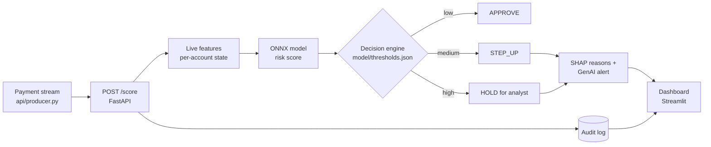

# ZShield

Real-time AI that stops fraudulent payments before the money leaves.
IBM Z Datathon 2026, Challenge 1: Real-Time AI for Critical Decisions.

## The problem

Instant payments cannot be called back. In its April 2026 discussion paper, the Reserve Bank of India says that because of the instantaneous nature of payments, "the scope for timely intervention and recovery of funds becomes limited" ([RBI, 9 Apr 2026](https://rbi.org.in/Scripts/PublicationsView.aspx?id=23810)). The same paper shows 28 lakh digital payment frauds, worth ₹22,931 crore, reported on the National Cyber Crime Reporting Portal in 2025. Today's checks often act after the money has gone, analysts drown in false alerts, and customers see blocks with no explanation.

How can we score every payment as it happens, stop the dangerous ones before settlement, explain the decision in plain language, and keep a human in control, without blocking honest customers?

[More: problem statement, personas, sourced statistics](docs/problem_statement.md)

## What it does

Every payment is scored in milliseconds and routed to one of three actions: **APPROVE**, **STEP_UP** (extra check), or **HOLD** (human analyst). Flagged payments come with top reasons (SHAP) and a plain-language alert (GenAI). The AI explains, a human decides.

## Architecture



Only flagged payments get the explanation step, so normal payments stay fast. If the model fails, the engine fails safe to STEP_UP and logs it. Endpoint shapes are in [docs/API_CONTRACT.md](docs/API_CONTRACT.md).

## Folder map

| Folder | Contents | Owner |
|---|---|---|
| data/ | Not committed. Local copy of shared data | Balaa |
| features/ | features.py, EDA notebook, data_card.md | Balaa |
| model/ | train.py, explain.py, model.onnx, thresholds.json, model_card.md | Joshua |
| api/ | FastAPI app, decision engine, state store, producer.py | Abhinava |
| genai/ | Prompts, generate_alert(), fallback templates, tests | Arun |
| dashboard/ | Streamlit app | Armaan |
| docs/ | README assets, API contract, responsible AI, deck, screenshots | Vishaal, Arun |

## Quick start

```bash
python -m venv .venv
source .venv/bin/activate        # Windows: .venv\Scripts\activate
pip install -r requirements-api.txt
uvicorn api.main:app --reload --port 8000
# in a second terminal:
curl http://localhost:8000/health
python smoke_test.py             # checks every endpoint, prints PASS / WARN / FAIL
```

Stream demo payments into the API (needs `data/demo_stream.csv`, see data/README.md):

```bash
python -m api.producer data/demo_stream.csv --rate 50 --limit 500
```

Dashboard (standalone synthetic-data prototype):

```bash
pip install -r requirements-dashboard.txt
streamlit run dashboard/app.py
```

Training / EDA environment:

```bash
pip install -r requirements-train.txt
```

## IBM Z / LinuxONE

**Why IBM Z.** Core banking and payment systems commonly run on IBM Z. Scoring inside the transaction path avoids a network round trip to an outside ML server and keeps sensitive data on the platform.

**Designed for Z.** The model is exported as ONNX, which is portable. The scoring API needs only the small set of packages in `requirements-api.txt` (fastapi, uvicorn, pydantic, numpy, onnxruntime, httpx). Training and SHAP explanation stay off-platform.

**What we actually ran on IBM Z.**

| Item | Result |
|---|---|
| Environment | IBM LinuxONE Community Cloud, [image name] |
| Architecture check (`uname -m`) | [s390x] |
| Scoring API running on Z | [yes / no] |
| Packages installed | [list] |
| Packages that failed, and workaround | [list] |
| Latency measured on Z (from `/stats`) | [avg ms, p95 ms] |
| Screenshots | docs/screenshots/[file names] |

<!-- Fill in ONLY what we truly ran, then delete this comment. If we did not get a run on Z, replace the table with one honest sentence saying so. -->

## Responsible AI

See the [responsible AI checklist](docs/responsible_ai.md). The GenAI alert layer only rephrases supplied facts and never changes a decision: [genai/DESIGN.md](genai/DESIGN.md).

## Data

Synthetic transactions (PaySim, 6.36M rows, 0.13% fraud). No real personal data.

- Data card, splits and limitations: [features/data_card.md](features/data_card.md)
- One-page methodology for the deck: [docs/data_methodology.md](docs/data_methodology.md)
- EDA charts: `docs/eda/` (notebook: `features/eda.ipynb`)
- Demo stream, 3 demo stories and 10 edge cases: `docs/demo/`
- Rebuild everything: `python -m features.prepare_data data/paysim.csv` (see data/README.md)

## Limitations

The data is synthetic and easier than real-world fraud, so our metrics are not a promise of production performance. Fraudsters adapt, so a real deployment needs drift monitoring and regular retraining. ZShield recommends; a human analyst makes the final call on held payments.

## Team

Vishaal (lead, IBM Z), Balaa (data), Joshua (ML), Abhinava (backend), Armaan (dashboard), Arun (GenAI, story)

## Git rules

- One branch per person: name/feature (example: joshua/train-model)
- Small commits, clear messages
- Open a pull request into main. Vishaal merges.
- Never commit data files, keys, or passwords
